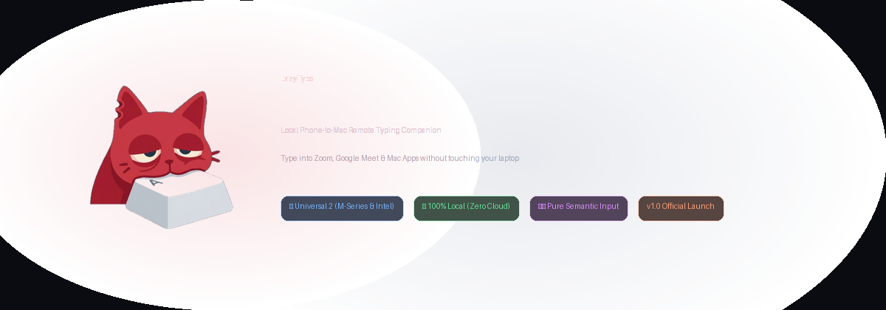
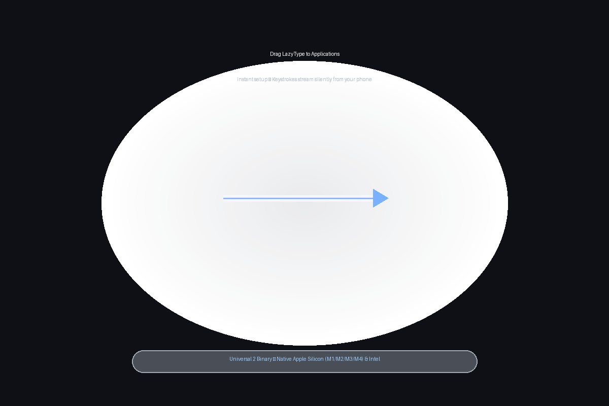
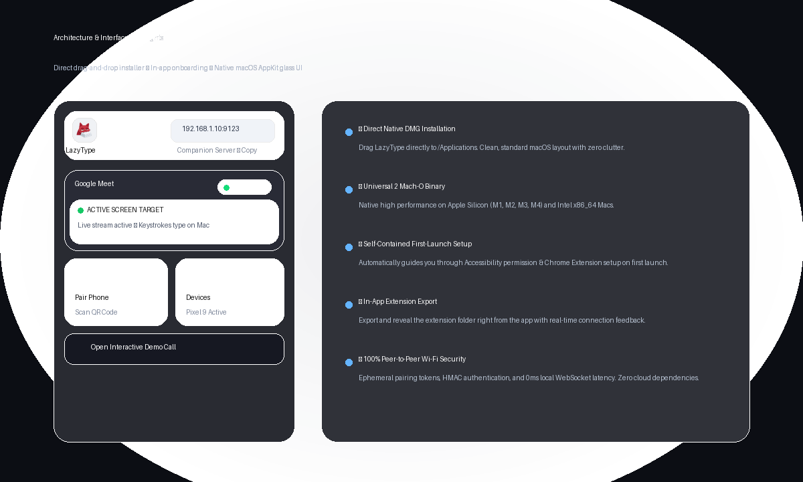

<div align="center">



<br/>
<br/>

[-000000?style=for-the-badge&logo=apple&logoColor=white)](https://github.com/Praful-7723/lazytype/releases/latest)
[](https://github.com/Praful-7723/lazytype/releases/latest)
[](https://swift.org)
[](https://developer.chrome.com/docs/extensions/mv3/intro/)
[](scripts/test-e2e.js)
[](LICENSE)

<p align="center">
  <b>Type, draft, and send messages during Zoom, Google Meet, Teams, and video calls on your Mac directly from your phone.</b><br/>
  <i>Zero trackpad movement. Zero awkward leaning. Pure local peer-to-peer connection with 0ms latency.</i>
</p>

[**⬇️ Download LazyType for Mac (DMG)**](https://github.com/Praful-7723/lazytype/releases/download/v1.0.0/LazyType-1.0.0.dmg) • [**Quickstart Guide**](#-quickstart-in-60-seconds) • [**Architecture**](#-how-it-works) • [**Security**](#-security-by-design)

</div>

---

## ⚡ The Problem & The Solution

During remote meetings, meetings on external displays, or presentations:
- **The Problem:** Reaching over to your laptop keyboard or trackpad to type in Zoom or Google Meet chat interrupts your focus, moves your video posture, and distracts participants.
- **The Solution:** Keep your phone casually in your hand. Type comfortably using your phone's keyboard (or voice dictation). Your keystrokes stream directly into the active meeting chat or document in real time.

---

## 🎁 Native Mac Drag-and-Drop Installation

<div align="center">
  
</div>

1. **[Download `LazyType-1.0.0.dmg`](https://github.com/Praful-7723/lazytype/releases/download/v1.0.0/LazyType-1.0.0.dmg)**
2. Double-click the DMG and drag **LazyType** straight into your **Applications** folder.
3. Open **LazyType** from Applications.

> **Universal 2 Binary**: Pre-compiled natively for all Macs — including **Apple Silicon (M1, M2, M3, M4)** and **Intel (`x86_64`)** without requiring Rosetta 2.

---

## 🚀 Quickstart in 60 Seconds

When you open LazyType for the first time, a streamlined setup window guides you through the 2 quick steps:

<div align="center">
  
</div>

### 1. macOS Accessibility
Click **"Open System Settings"** in the setup window and toggle LazyType **ON** under *Privacy & Security ➔ Accessibility*. This enables the companion to type into Zoom and frontmost applications.

### 2. Chrome Extension (For Google Meet, Zoom Web, Teams)
LazyType contains the browser bridge directly inside the app bundle:
1. Click **"Open Chrome & Reveal Extension Folder"** in the setup guide.
2. In Google Chrome, turn on **Developer mode** (top-right toggle at `chrome://extensions`).
3. Drag the revealed `extension` folder into Chrome.
4. The live status indicator in LazyType instantly turns green (`Connected ✓`).

### 3. Scan & Type
1. Click the **LazyType Mascot** in your macOS menu bar.
2. Click **"Pair Phone"** to reveal your unique QR code.
3. Scan the QR code with your phone camera on the same Wi-Fi.
4. Start typing! Whatever you type streams instantly to your Mac.

---

## 🏛️ How It Works

LazyType is completely decoupled into three lightweight layers communicating over high-speed local WebSockets:

```
┌──────────────────────────────────────┐
│       Mobile Web Companion (PWA)     │
│   • Minimalist dark glass UI         │
│   • Thumb-friendly touch targets     │
│   • Voice dictation + Live Streaming │
└──────────────────▲───────────────────┘
                   │ Local Wi-Fi WebSocket (ws://<mac-ip>:9123)
                   ▼
┌──────────────────────────────────────────────────────────────┐
│                    macOS Companion App                       │
│   • Native AppKit Menu Bar Accessory (Swift)                 │
│   • Embedded Zero-Dependency HTTP & RFC 6455 Server          │
│   • Cryptographic Device Pairing & Revocation Manager        │
│   • Smart Target Resolver & Adaptive Accessibility Traversal │
│                                                              │
│   ┌────────────────────────┬─────────────────────────────┐   │
│   │ Native AppKit Adapters │ Chromium WebSocket Bridge   │   │
│   │ • Zoom Native Adapter  │ • Google Meet Adapter       │   │
│   │ • Generic CGEvent      │ • Teams Web & Zoom Web      │   │
│   └───────────┬────────────┴──────────────┬──────────────┘   │
└───────────────┼───────────────────────────┼──────────────────┘
                │                           │
                ▼                           ▼
        macOS Accessibility        Chrome MV3 Extension
         (AXUIElement API)           (Reactive DOM Bridge)
                │                           │
                ▼                           ▼
          [Native Zoom]             [Google Meet & Tabs]
```

### 1. macOS Companion (`mac/`)
- Written in **Swift** using native AppKit and CoreGraphics.
- Uses semantic accessibility traversal (`AXUIElement`) rather than fragile pixel coordinates or mouse automation.
- Includes embedded HTTP/WebSocket server with zero external dependencies.

### 2. Phone Companion PWA (`phone/`)
- Served directly by your Mac over your local network (`http://<mac-ip>:9123`).
- Can be added to your home screen as a standalone Progressive Web App.
- Modes:
  - **Send Mode**: Compose message and hit SEND.
  - **Insert Only**: Types directly into the focused field without hitting Enter.
  - **Live Typing**: Real-time keystroke streaming with 150ms debounce.

### 3. Chromium Extension (`extension/`)
- Manifest V3 extension bridging the companion to web video calls (Google Meet, Zoom Web, Teams, Slack).
- Dispatches synthetic reactive DOM input events (`beforeinput`, `input`, and Enter) compatible with React, Vue, and Angular input forms.

---

## 🔒 Security by Design

Remote typing requires ironclad local security:

- **100% Local (Zero Cloud)**: All traffic flows strictly between your phone and Mac over your local Wi-Fi or hotspot. No remote servers, no third-party tracking, no telemetry.
- **Ephemeral Pairing Tokens**: QR codes use single-use cryptographic tokens expiring after 5 minutes.
- **Session Authentication**: After pairing, commands require HMAC session tokens stored locally.
- **Instant Revocation**: Inspect all active devices in the Mac companion's **"Connected Devices"** panel and revoke any device with a single click.

---

## 🧪 Automated Verification Suite

Run the full end-to-end automated test suite:

```bash
npm test
```

Verifies:
- Static PWA asset and QR PNG delivery
- Unauthorized command rejection & security handshake
- Session persistence across reconnections
- Vertical slice command dispatch: `Phone ➔ Mac ➔ Extension ➔ DOM ➔ Confirmation`
- Generic `CGEvent` keyboard injection fallback

---

## 🛠️ Building from Source

```bash
# Clone the repository
git clone https://github.com/Praful-7723/lazytype.git
cd lazytype

# Install dev dependencies
npm install

# Compile Universal 2 binary (arm64 + x86_64)
./scripts/build-mac.sh

# Package macOS App bundle
./scripts/package-app.sh

# Build clean direct DMG installer
./scripts/create-dmg.sh
```

---

## 📄 License

MIT License. Designed with care for effortless remote typing.
