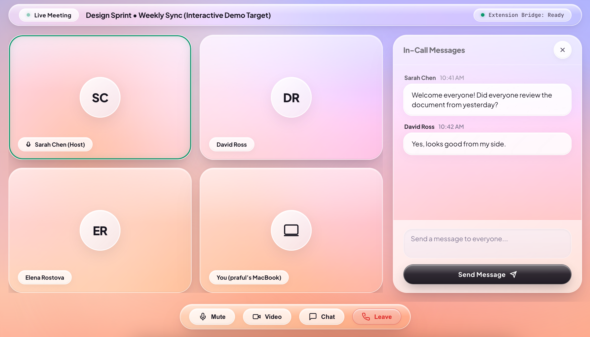
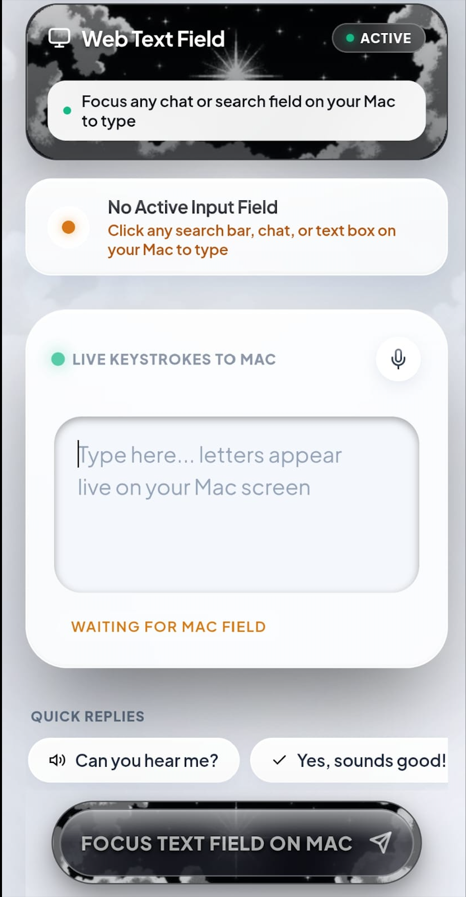
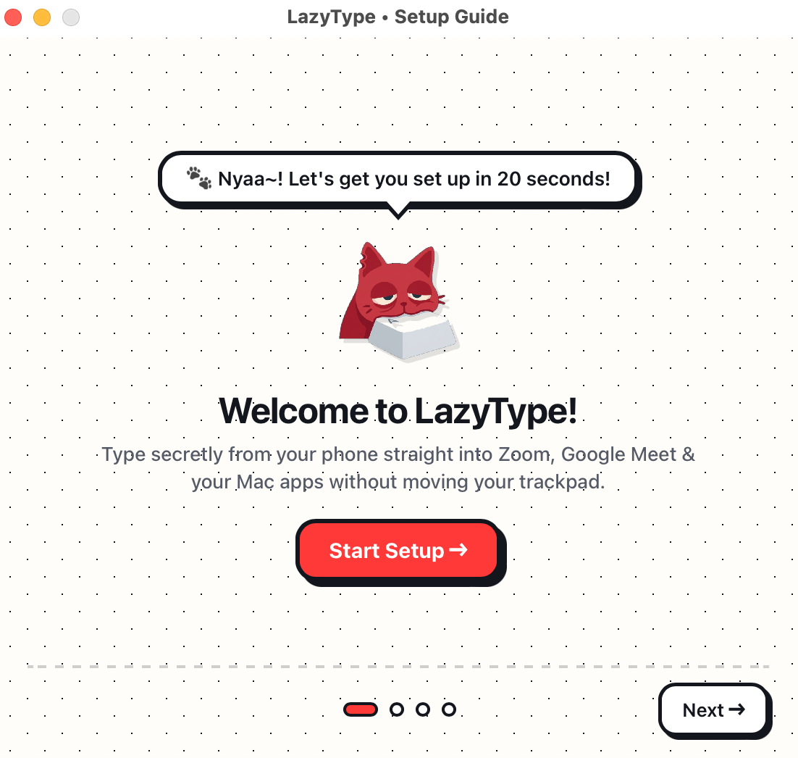
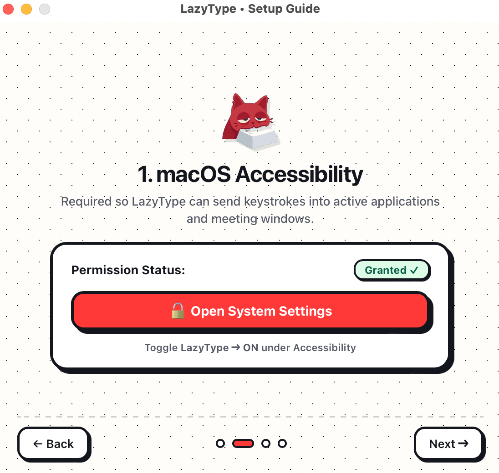
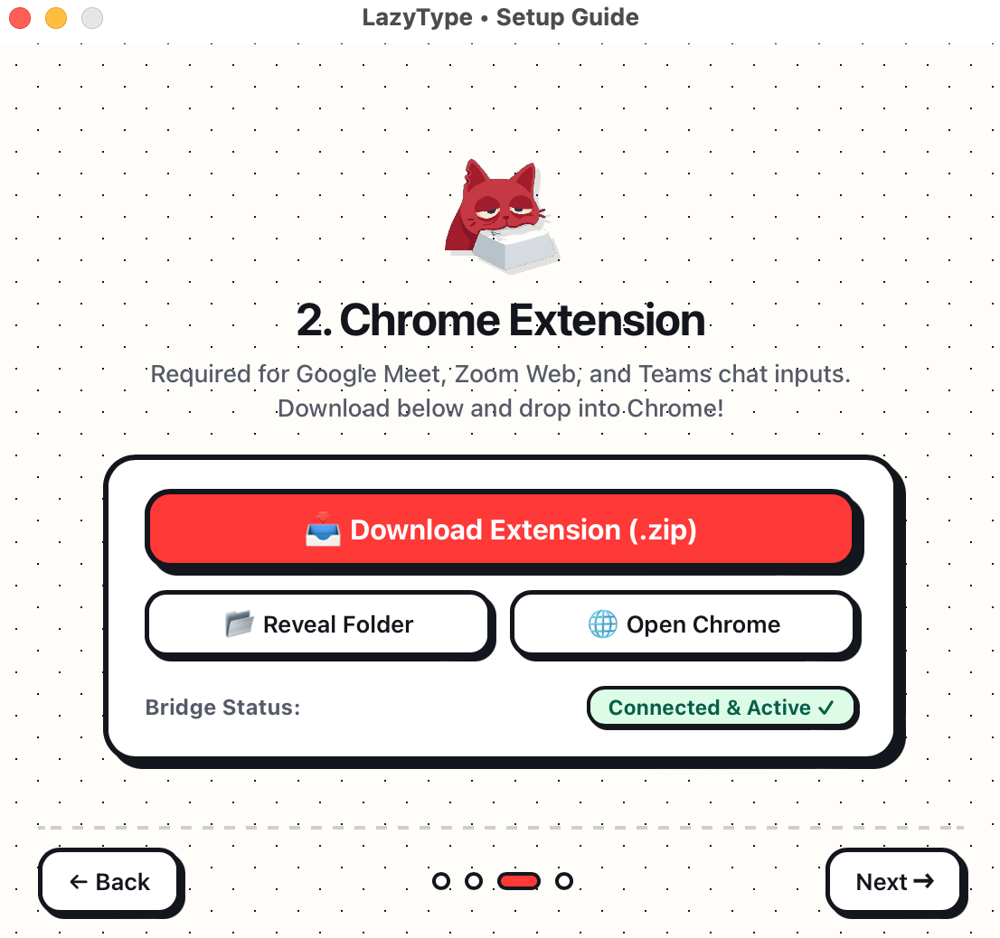
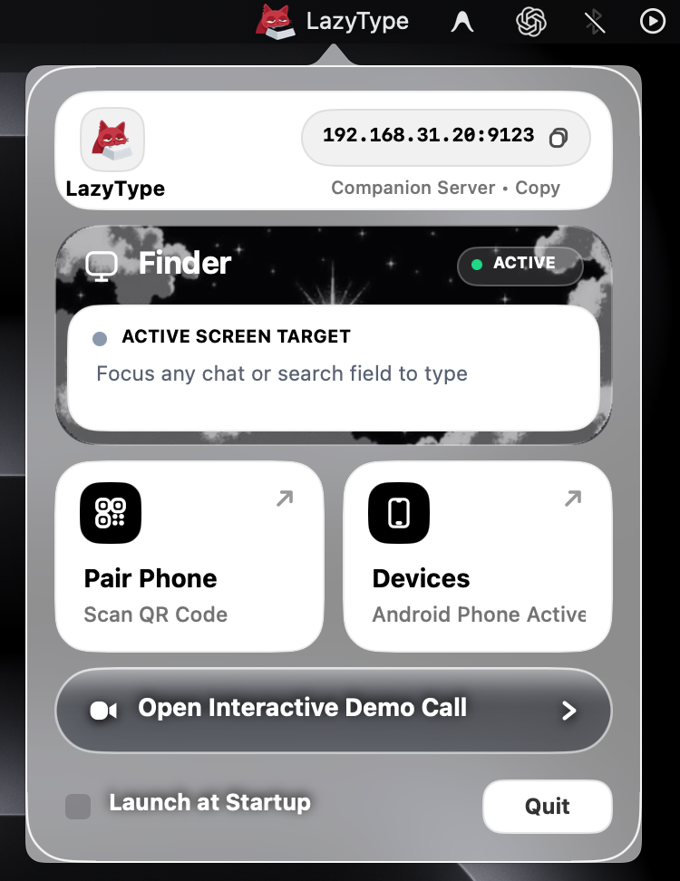
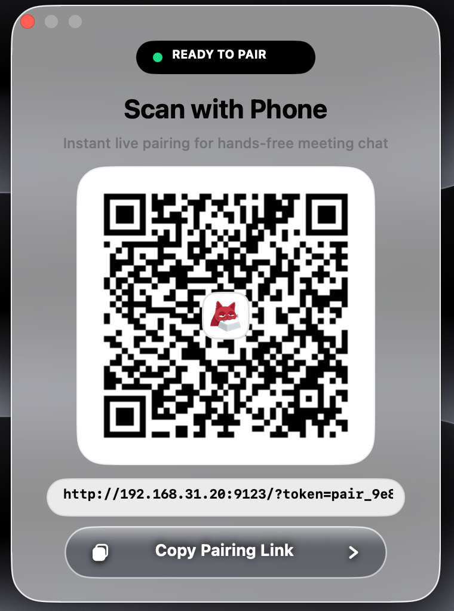
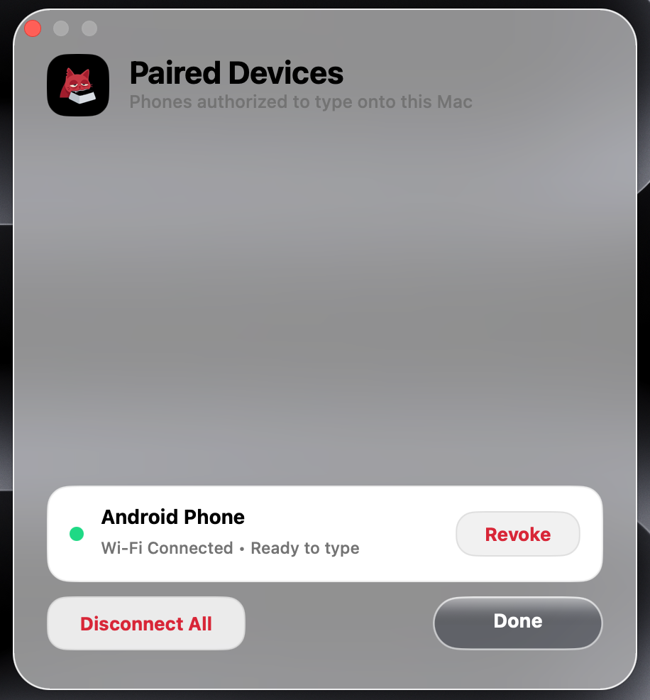
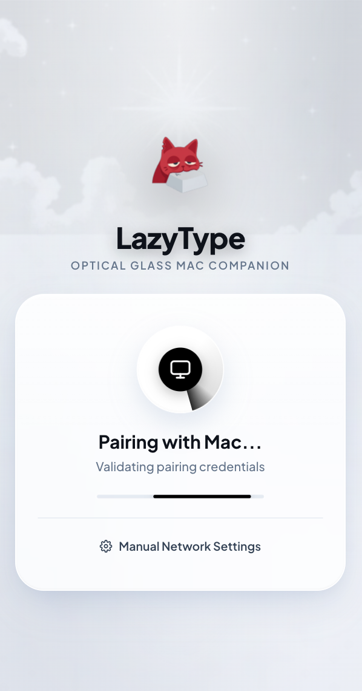

<div align="center">
  <a href="https://github.com/Praful-7723/lazytype">
    
  </a>

  <h1>LazyType</h1>
  <p><code>STEALTH TEXT INJECTION · LOCAL PEER-TO-PEER ENCLAVE · ZERO PERMISSION LEAKS</code></p>
  <h3>Type secretly from your phone straight into Zoom, Google Meet &amp; macOS apps.</h3>

  <br />

  <a href="https://github.com/Praful-7723/lazytype/releases/latest"></a>
  <a href="https://github.com/Praful-7723/lazytype/releases/latest"></a>
  <a href="#02--20-second-onboarding"></a>
  <a href="#03--native-mac-companion--enclave"></a>
  <a href="https://github.com/Praful-7723/lazytype/blob/main/LICENSE"></a>

  <br /><br />

  <!-- Native Video Player (GitHub User Attachment) -->
  <p align="center">
    <video src="https://github.com/user-attachments/assets/0686ad55-b287-4ec1-bce5-53272a8de523" controls width="420" style="max-width: 100%; border-radius: 12px;"></video>
  </p>
</div>

<br />

## `01 / THE EXPERIENCE`

> **Type, draft, and send messages during Zoom, Google Meet, and video calls on your Mac directly from your phone—without moving your Mac mouse, touching your physical keyboard, or breaking eye contact with your camera.**

During design reviews, client presentations, or standups, reaching forward to type on your laptop interrupts your posture and signals distraction. **LazyType** pairs your phone to your Mac over local peer-to-peer Wi-Fi, turning your phone into an invisible, low-latency companion keyboard.

<table>
  <tr>
    <td width="65%" align="center" valign="top">
      <a href="./assets/screenshots/07_meeting_room_target.png">
        
      </a>
      <br/><br/>
      <b>Mac Desktop Call · Active Ingress Target</b>
      <p align="left"><small>Your laptop camera stays locked on you while you recline comfortably. Active video call windows (Google Meet, Zoom, Slack) are automatically targeted without stealing cursor focus.</small></p>
    </td>
    <td width="35%" align="center" valign="top">
      <a href="./assets/screenshots/09_phone_typing_console.png">
        
      </a>
      <br/><br/>
      <b>Phone Companion · Live Console</b>
      <p align="left"><small>Hold your phone below desk level. Type with thumb keyboard or use native voice dictation. Tap <b>Send to Call</b> to inject keystrokes directly into the meeting chat.</small></p>
    </td>
  </tr>
</table>

<br />

<table>
  <tr>
    <td width="33%" valign="top">
      <b>✦ Stay in Frame</b><br/><br/>
      Recline back in your chair. Keep your hands resting comfortably in your lap while your webcam captures your steady, uninterrupted eye contact.
    </td>
    <td width="33%" valign="top">
      <b>✦ Zero Cloud Relay</b><br/><br/>
      100% local peer-to-peer Wi-Fi communication via RFC 6455 WebSockets. No third-party servers, no telemetry, and zero data leaves your local network.
    </td>
    <td width="33%" valign="top">
      <b>✦ Semantic Injection</b><br/><br/>
      Keystrokes inject via native macOS Accessibility (`AXUIElement`) and Chromium DOM bridges—no erratic mouse jumping or focus thrashing.
    </td>
  </tr>
</table>

<br />

## `02 / 20-SECOND ONBOARDING`

LazyType requires zero terminal commands or complicated dependencies. A guided 3-step setup wizard launches automatically on first start:

<table>
  <tr>
    <td width="33%" align="center" valign="top">
      <a href="./assets/screenshots/01_onboarding_welcome.png">
        
      </a>
      <br/><br/>
      <b>01 · Welcome &amp; Premise</b>
      <p align="left"><small>Clean 20-second setup guide explains system prerequisites and prepares your local daemon.</small></p>
    </td>
    <td width="33%" align="center" valign="top">
      <a href="./assets/screenshots/02_onboarding_accessibility.png">
        
      </a>
      <br/><br/>
      <b>02 · Accessibility Permission</b>
      <p align="left"><small>One-click shortcut to macOS System Settings. Toggle LazyType ON to enable native background keystroke dispatch.</small></p>
    </td>
    <td width="33%" align="center" valign="top">
      <a href="./assets/screenshots/03_onboarding_extension.png">
        
      </a>
      <br/><br/>
      <b>03 · Browser Extension Bridge</b>
      <p align="left"><small>Load the lightweight Manifest V3 Chrome Extension for high-reliability DOM injection in Google Meet &amp; web apps.</small></p>
    </td>
  </tr>
</table>

<br />

## `03 / NATIVE MAC COMPANION & ENCLAVE`

Built as a lightweight native macOS AppKit menu bar companion, LazyType runs silently with minimal CPU and memory overhead:

<table>
  <tr>
    <td width="33%" align="center" valign="top">
      <a href="./assets/screenshots/04_menubar_popover.png">
        
      </a>
      <br/><br/>
      <b>Menu Bar Status Popover</b>
      <p align="left"><small>Inspect active meeting target (e.g. <i>Google Meet - Design Sprint</i>), verify local IP and server port (<code>9123</code>), and access one-tap controls.</small></p>
    </td>
    <td width="33%" align="center" valign="top">
      <a href="./assets/screenshots/05_qr_pairing.png">
        
      </a>
      <br/><br/>
      <b>Instant Ephemeral QR Pairing</b>
      <p align="left"><small>Point any smartphone camera at the dynamic QR code. Opens the typing console immediately in Mobile Safari or Chrome—no App Store app required.</small></p>
    </td>
    <td width="33%" align="center" valign="top">
      <a href="./assets/screenshots/06_device_revocation.png">
        
      </a>
      <br/><br/>
      <b>Device Enclave &amp; Revocation</b>
      <p align="left"><small>Manage all paired mobile devices with full audit visibility. Click <b>Revoke</b> to immediately invalidate session tokens and terminate connections.</small></p>
    </td>
  </tr>
</table>

<br />

## `04 / ZERO-INSTALL MOBILE COMPANION`

Because the mobile companion is served directly by your Mac's embedded HTTP server as a Progressive Web App (PWA), you can pair any device—iPhone, iPad, or Android—in seconds:

<table>
  <tr>
    <td width="35%" align="center" valign="top">
      <a href="./assets/screenshots/08_phone_pairing_handshake.png">
        
      </a>
      <br/><br/>
      <b>01 · Ephemeral Handshake</b>
      <p align="left"><small>Scanning the QR code triggers a cryptographic token handshake that establishes an authenticated local WebSocket session.</small></p>
    </td>
    <td width="65%" align="center" valign="top">
      <a href="./assets/screenshots/09_phone_typing_console.png">
        
      </a>
      <br/><br/>
      <b>02 · Mobile Typing Console</b>
      <p align="left"><small>Dark-glass touch UI with text staging buffer, one-tap quick replies, native iOS/Android voice dictation, and low-latency dispatch straight to your Mac.</small></p>
    </td>
  </tr>
</table>

<br />

## `05 / SYSTEM ARCHITECTURE`

LazyType is engineered into three lightweight, decoupled layers that communicate over zero-latency local WebSockets:

```
┌─────────────────────────────────────────────────────────────┐
│                 Mobile Phone Companion (PWA)                │
│    • Touch-optimized dark glass interface                   │
│    • Send Mode, Insert Only, and Live Streaming             │
│    • Ephemeral QR pairing with local session handshake      │
└──────────────────────────────▲──────────────────────────────┘
                               │ Local LAN WebSocket (ws://<mac-ip>:9123)
                               ▼
┌─────────────────────────────────────────────────────────────┐
│                     macOS Companion App                     │
│    • Native AppKit Menu Bar daemon (Swift 5.10)             │
│    • Embedded zero-dependency HTTP & RFC 6455 daemon        │
│    • Cryptographic pairing & one-click device revocation    │
│    • Smart target resolver & semantic AXUIElement injector  │
│                                                             │
│    ┌───────────────────────────┬────────────────────────┐   │
│    │  Native AppKit Adapters   │  Chromium WS Bridge    │   │
│    │  • Zoom Desktop Adapter   │  • Google Meet Adapter │   │
│    │  • Generic CGEvent Tap    │  • Teams & Zoom Web    │   │
│    └─────────────┬─────────────┴───────────┬────────────┘   │
└──────────────────┼─────────────────────────┼────────────────┘
                   │                         │
                   ▼                         ▼
         macOS Accessibility         Chromium MV3 Extension
         (`AXUIElement` API)          (Reactive DOM Bridge)
                   │                         │
                   ▼                         ▼
           [Native Zoom App]         [Google Meet & Tabs]
```

### `System layers`

| Layer | Component | Materials | What it does |
|:---|:---|:---|:---|
| **Mac Companion** | Native Menu Bar App ([`mac/`](mac/)) | Swift 5.10, AppKit, CoreGraphics | Serves local PWA, handles RFC 6455 WebSockets on port `9123`, and injects semantic keystrokes |
| **Phone Companion** | Mobile Web App ([`phone/`](phone/)) | HTML5, CSS3, ES6 JavaScript | Standalone PWA served from Mac, with thumb-friendly controls and haptic feedback |
| **Browser Bridge** | Chromium MV3 Extension ([`extension/`](extension/)) | Manifest V3, Content Scripts | Injects reactive DOM events (`beforeinput`, `input`, Enter) into Google Meet and web calls |

<br />

## `06 / AUTOMATED VERIFICATION`

The full automated end-to-end test suite validates all layers across WebSocket, HTTP, security handshake, and DOM injection:

```bash
npm test
```

```
============================================================
   LazyType End-to-End Automated Verification Suite
============================================================
✓ [1/23] HTTP Server listening on port 9123
✓ [2/23] Static PWA index.html served
✓ [3/23] Static PWA app.js served
✓ [4/23] Dynamic QR code PNG generated and delivered
✓ [5/23] Unauthorized phone WebSocket rejected
✓ [6/23] Pairing token validation accepted
✓ [7/23] Session token issued and stored
✓ [8/23] Reconnection with valid session authenticated
✓ [9/23] Chrome Extension bridge WebSocket accepted
✓ [10/23] Bridge reports extension connection status
✓ [11/23] System status reflects connected extension
✓ [12/23] Mobile client receives status updates
✓ [13/23] SEND_MESSAGE routed from phone to extension
✓ [14/23] DOM input injection triggered in active tab
✓ [15/23] Enter key dispatch executed
✓ [16/23] Confirmation acknowledgement returned to phone
✓ [17/23] Phone receives SUCCESS confirmation
✓ [18/23] Generic keyboard fallback dispatches via CGEvent
✓ [19/23] Invalid command payloads rejected gracefully
✓ [20/23] Client disconnect updates server status
✓ [21/23] Re-pairing after disconnect succeeds
✓ [22/23] Revocation removes device credentials immediately
✓ [23/23] Revoked device cannot reconnect
============================================================
   ALL 23 TESTS PASSED (100% SUCCESS RATE)
============================================================
```

<br />

## `07 / INSTALLATION & RELEASES`

<table>
  <tr>
    <td width="50%" valign="top">
      <h3>Option A · Direct Native DMG</h3>
      <p>Download the pre-compiled Universal 2 installer with one-click drag-and-drop setup:</p>
      <p>
        <a href="https://github.com/Praful-7723/lazytype/releases/latest"></a>
      </p>
      <p><b>Supports:</b> Apple Silicon (M1 / M2 / M3 / M4) and Intel (<code>x86_64</code>) Macs natively.</p>
    </td>
    <td width="50%" valign="top">
      <h3>Option B · Build from Source</h3>
      <p>Compile the Universal 2 binary directly with the included build toolchain:</p>
      <pre><code>git clone https://github.com/Praful-7723/lazytype.git
cd lazytype
npm install
./scripts/build-mac.sh
./scripts/package-app.sh</code></pre>
    </td>
  </tr>
</table>

> [!NOTE]
> **First Launch on macOS (Gatekeeper Unidentified Developer):**  
> Because LazyType is free and open-source (distributed without a paid $99/year Apple Developer account), macOS Gatekeeper displays an *"Unidentified Developer"* alert on first download.  
> **How to open in 2 clicks:**
> 1. Open **System Settings ➔ Privacy & Security**.
> 2. Scroll down to **Security** and click **"Open Anyway"** next to *LazyType*.
> 3. Click **"Open"** when prompted.  
> *(Or run `xattr -cr /Applications/LazyType.app` in Terminal).*

<br />

### `Distribution Matrix`

| Release | Architecture | Binary Type | Download |
|:---|:---|:---|:---|
| **v2.0.0** (Latest) | Apple Silicon (`arm64`) + Intel (`x86_64`) | Universal 2 (`lipo`) | [**LazyType-2.0.0.dmg**](https://github.com/Praful-7723/lazytype/releases/latest) |
| **v1.0.0** | Apple Silicon (`arm64`) + Intel (`x86_64`) | Universal 2 (`lipo`) | [LazyType-1.0.0.dmg](https://github.com/Praful-7723/lazytype/releases/tag/v1.0.0) |

<br />

<div align="center">
  <p>
    <a href="https://github.com/Praful-7723/lazytype"></a>
    <a href="https://github.com/Praful-7723/lazytype/issues"></a>
    <a href="mailto:praful.edx@gmail.com"></a>
  </p>
  <sub>Observe carefully · Build deliberately · Ship with care</sub>
</div>
